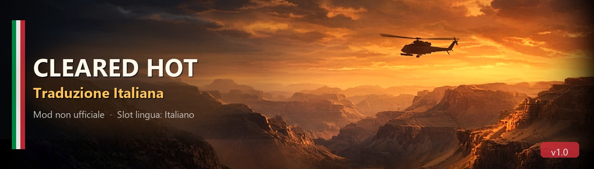

# Cleared Hot — Traduzione Italiana

Traduzione italiana non ufficiale per **Cleared Hot**.  
Il gioco non ha uno slot IT nativo: la mod sostituisce lo **slot Francese** e rinomina la voce di menu in **Italiano**.

Il download da questa repository è il canale più rapido. Nexus Mods resta disponibile, ma gli aggiornamenti arrivano prima qui.

## Requisiti

- Windows
- [Python 3](https://www.python.org/downloads/) (consigliato 3.10+)
- Cleared Hot installato (Steam)
- Chiudi il gioco prima di installare o ripristinare

## Installazione

1. Su GitHub apri **Code → Download ZIP** ed estrai la cartella
2. Doppio clic su `Installa_Traduzione.bat`
   - alla prima esecuzione installa automaticamente `UnityPy`
3. Nella finestra: **Installa traduzione**
4. Avvia Cleared Hot → Impostazioni → Lingua → **Italiano**

### Pulsanti injector

| Pulsante | Funzione |
|----------|----------|
| Installa traduzione | Backup di `resources.assets` + inject IT |
| Verifica | Controlla che lo slot FR contenga l’italiano |
| Ripristina originale | Torna al backup (francese originale) |

Il backup si chiama `resources.assets.clearedhot_it_backup` e resta in `ClearedHot_Data`.

## Dopo un aggiornamento del gioco

Steam può sovrascrivere `resources.assets`. In quel caso:

1. Verifica file di gioco (Steam) se qualcosa non parte
2. Rilancia `Installa_Traduzione.bat` → Installa di nuovo

## Note

- Mod non ufficiale, non affiliata agli sviluppatori di Cleared Hot
- Modifica file di gioco: usa il backup / verifica file Steam se serve
- Testata sull’hangar e sul menu dopo la correzione stringhe HELO
- In gioco la voce di lingua compare come **Italiano** (al posto del Francese)

## Crediti

- Traduzione / tool: AndyD
- Gioco: Cleared Hot © rispettivi autori

## Supporta il progetto

Se la traduzione ti è utile, puoi offrirmi un caffè:

